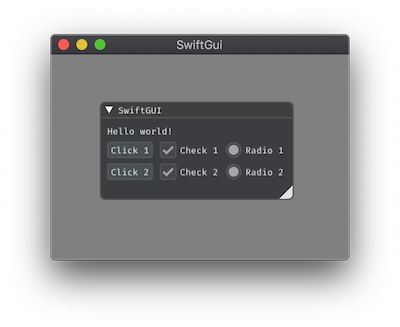
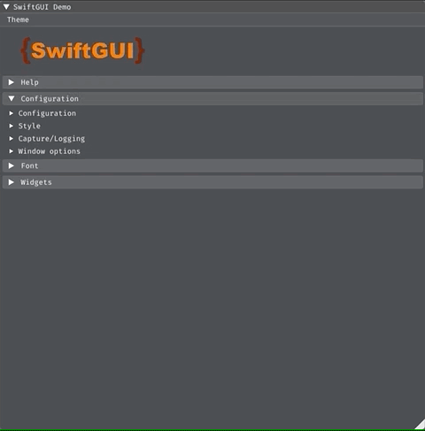
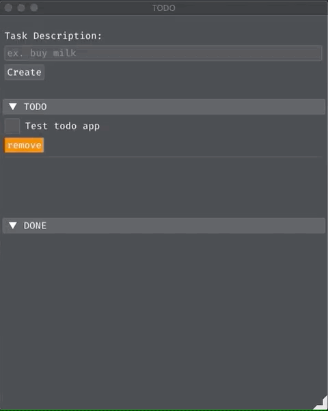

<center>


[](https://swift.org/download)
[](https://swift.org/package-manager/)

**SwiftGUI 2.0** - A declarative UI framework bringing SwiftUI-like syntax to Dear ImGui

*Build beautiful, cross-platform GUIs with the elegance of SwiftUI and the performance of immediate mode rendering*

</center>

<p align="center">
    
</p>

---

## ✨ What is SwiftGUI?

SwiftGUI combines the best of two worlds:

- **SwiftUI's elegance** - Declarative syntax, `@State`, `Binding`, and result builders
- **ImGui's power** - Immediate mode rendering, cross-platform, perfect for tools and editors

Write your UI once in clean, modern Swift and get instant visual feedback with Dear ImGui's proven rendering engine.

```swift
import SwiftGUI

struct CounterApp: GuiView {
    @State var count = 0

    func render() {
        Window("Counter") {
            Text("Count: \(count)")
                .font(1)
                .textColor(.cyan)

            HStack(spacing: 10) {
                Button("Increment") { count += 1 }
                    .backgroundColor(.green)

                Button("Decrement") { count -= 1 }
                    .backgroundColor(.red)
            }
        }
    }
}
```

## 🚀 What's New in 2.0

SwiftGUI 2.0 is a **complete rewrite** with modern Swift features:

- ✅ **Struct-based views** with value semantics (goodbye classes!)
- ✅ **@State and Binding** for reactive state management
- ✅ **@resultBuilder** for type-safe DSL
- ✅ **Protocol-based modifiers** with copy-on-modify pattern
- ✅ **Swift 5.9+** with improved type inference
- ✅ **Swift Package Manager** support
- ✅ **Comprehensive documentation** - 3,000+ lines covering every API

## 🎯 Why SwiftGUI?

| Feature | SwiftGUI | SwiftUI | Dear ImGui |
|---------|----------|---------|------------|
| **Syntax** | ✅ Declarative, SwiftUI-like | ✅ Declarative | ❌ Imperative C++ |
| **Platforms** | ✅ macOS, iOS, Linux*, Windows* | ❌ Apple only | ✅ Cross-platform |
| **Use Case** | ✅ Tools, editors, debug UIs | ✅ Apps | ✅ Tools, games |
| **Immediate Mode** | ✅ Yes (ImGui) | ❌ No (retained) | ✅ Yes |
| **State Management** | ✅ @State, Binding | ✅ @State, Binding | ❌ Manual |
| **Type Safety** | ✅ Swift type system | ✅ Swift type system | ⚠️ C++ templates |

*Platform support depends on ImGui backend configuration

**Perfect for:**
- 🛠 Development tools and utilities
- 🎮 Game editors and debug UIs
- 📊 Data visualization tools
- ⚙️ System configuration UIs
- 🔧 Internal tools and dashboards

## 📦 Installation

### Swift Package Manager

Add SwiftGUI to your `Package.swift`:

```swift
dependencies: [
    .package(url: "https://github.com/erickjung/SwiftGUI.git", branch: "2.0")
]
```

### Xcode

1. **File > Add Package Dependencies**
2. Enter: `https://github.com/erickjung/SwiftGUI`
3. Select branch: `2.0`

## 🏃 Quick Start

```swift
import SwiftGUI

struct MyView: GuiView {
    @State var name = "World"
    @State var count = 0

    func render() {
        Window("My First App") {
            Text("Hello, \(name)!")
                .font(1)
                .textColor(.cyan)

            TextField(label: "Name", text: $name)

            Button("Click me!") {
                count += 1
            }
            .backgroundColor(.blue)

            Text("Clicked \(count) times")
        }
    }
}

@main
struct MyApp {
    static func main() {
        GuiAppLauncher.run(
            title: "My App",
            scene: MyView()
        )
    }
}
```

Run it:
```bash
swift run
```

👉 See the [**Getting Started Guide**](Docs/getting-started.md) for detailed setup instructions.

## 🎨 Rich Component Library

SwiftGUI provides 40+ production-ready components:

### Layout & Containers
`Window`, `SubWindow`, `Group`, `HStack`, `Column`, `TabBar`, `TabItem`, `CollapsingHeader`, `Tree`, `Popup`

### Controls
`Button`, `CheckBox`, `RadioButton`, `Slider`, `Drag`, `TextField`, `TextEditor`, `ComboBox`, `ListBox`, `ColorEdit`, `MenuBar`

### Display
`Text`, `TextLabel`, `Image`, `Plot`, `Tooltip`, `Divider`

### Utilities
`ForEach`, `NewLine`, `SameLine`, `Spacing`, `Empty`

## 💡 Code Examples

### State Management

```swift
struct LoginForm: GuiView {
    @State var username = ""
    @State var password = ""
    @State var rememberMe = false

    func render() {
        Window("Login") {
            TextField(label: "Username", text: $username)
            TextField(type: .password, label: "Password", text: $password)
            CheckBox("Remember me", isOn: $rememberMe)

            Button("Login") {
                login()
            }
            .backgroundColor(.blue)
        }
    }
}
```

### Custom Components

```swift
struct UserCard: GuiView {
    let name: String
    let email: String

    func render() {
        HStack(spacing: 10) {
            Image(texture: avatar)
                .size(width: 50, height: 50)

            Group {
                Text(name).font(1).textColor(.white)
                Text(email).textColor(.gray)
            }
        }
    }
}
```

### Dynamic Lists

```swift
struct TodoList: GuiView {
    @State var items: [String] = []
    @State var newItem = ""

    func render() {
        Window("Todos") {
            ForEach(items) { item in
                Text("• \(item)")
            }

            Divider()

            TextField(text: $newItem, placeHolder: "New task...")
            Button("Add") {
                items.append(newItem)
                newItem = ""
            }
        }
    }
}
```

## 🎨 Powerful Modifiers

Style your views with chainable modifiers:

```swift
Text("Styled Text")
    .font(1)
    .textColor(.cyan)
    .padding(.all, value: 10)

Button("Primary Action") { performAction() }
    .backgroundColor(.blue)
    .activeColor(.darkBlue)
    .hoveredColor(.lightBlue)
    .size(width: 120, height: 35)
```

**Common Modifiers:** `textColor`, `backgroundColor`, `padding`, `font`, `size`, `activeColor`, `hoveredColor`, `identifier`

See [Modifiers API Reference](Docs/Api/modifiers.md) for the complete list.

## 📚 Comprehensive Documentation

SwiftGUI 2.0 includes extensive documentation (3,000+ lines):

### 🎓 Tutorials
- [**Building Your First App**](Docs/Tutorials/basic-app.md) - Step-by-step counter app
- [**State Management**](Docs/Tutorials/state-management.md) - Master @State and Binding
- [**Custom Views**](Docs/Tutorials/custom-views.md) - Create reusable components

### 📖 API Reference
- [**Views API**](Docs/Api/views.md) - Complete view types reference
- [**Controls API**](Docs/Api/controls.md) - Interactive controls
- [**State API**](Docs/Api/state.md) - @State and Binding
- [**Modifiers API**](Docs/Api/modifiers.md) - All available modifiers

### 📘 Guides
- [**Getting Started**](Docs/getting-started.md) - Installation and setup
- [**Architecture**](Docs/architecture.md) - How SwiftGUI works internally
- [**Best Practices**](Docs/Guides/best-practices.md) - Code organization and patterns

👉 **[Start with the Documentation →](Docs/README.md)**

## 🎬 Example Projects

Explore complete example applications:

<table>
 <tr>
  <th>
    
  </th>
  <th>
    
  </th>
 </tr>
 <tr>
  <th>
   <a href="Examples/Sample01Mac">Sample 01</a> - Basic Components
  </th>
  <th>
   <a href="Examples/Sample02Mac">Sample 02</a> - Advanced Features
  </th>
 </tr>
</table>

## 🎨 Themes

Built-in themes for instant polish:

```swift
DarculaTheme().apply()  // Dark theme
LightTheme().apply()    // Light theme
DefaultFontGroup().load()  // FiraCode font
```

## ❓ FAQ

### Why immediate mode?

Immediate mode means `render()` is called every frame (~60 FPS). You declare what should appear *right now*. No view tree is retained between frames.

**Benefits:** Simple mental model, no state sync issues, perfect for dynamic tool UIs.

### Why @State if it's immediate mode?

Because views are **structs** (value types) and `render()` is called every frame, local variables would reset each frame.

```swift
// ❌ Without @State - resets to 0 every frame!
func render() {
    var count = 0
}

// ✅ With @State - persists across frames
@State var count = 0
```

`@State` provides persistent storage that survives the ~60 `render()` calls per second.

See [State Management Tutorial](Docs/Tutorials/state-management.md) for details.

### SwiftGUI vs SwiftUI?

**SwiftGUI** is great for tools, editors, and debug UIs where immediate mode shines.

**SwiftUI** is better for traditional apps with standard UI patterns.

They have similar syntax but different rendering models and use cases.

### Production ready?

Yes! SwiftGUI 2.0 includes:
- ✅ Comprehensive test suite (238 tests)
- ✅ Complete documentation
- ✅ Stable API
- ✅ Active development

## 💻 Requirements

- **macOS**: 12.0+ (Monterey)
- **iOS**: 15.0+
- **Swift**: 5.9+
- **Xcode**: 14.0+ (for Apple platforms)

## 🤝 Contributing

Contributions welcome! Here's how to help:

1. 🐛 **Report bugs** via [GitHub Issues](https://github.com/erickjung/SwiftGUI/issues)
2. 💡 **Suggest features** - open a feature request
3. 📖 **Improve docs** - documentation PRs always welcome
4. 🔧 **Submit PRs** - see our contributing guidelines

### Development Setup

```bash
# Clone and build
git clone https://github.com/erickjung/SwiftGUI.git
cd SwiftGUI
swift build

# Run tests
swift test
```

## 📄 License

MIT License - Copyright (c) 2020-2026, Erick Jung

Free to use in commercial and open source projects.

## 🙏 Credits

SwiftGUI is built on:

- **[Dear ImGui](https://github.com/ocornut/imgui)** (1.77) - Omar Cornut's immediate mode GUI library
- **[ImGuiColorTextEdit](https://github.com/BalazsJako/ImGuiColorTextEdit)** - Syntax-highlighted text editor
- **[SwiftUI](https://developer.apple.com/xcode/swiftui/)** - Inspiration for the declarative API
- **The Swift Community** - For amazing language features

## 🔗 Links

- 📖 [**Complete Documentation**](Docs/README.md)
- 🚀 [**Getting Started**](Docs/getting-started.md)
- 📚 [**API Reference**](Docs/Api/)
- 🐛 [**Issues**](https://github.com/erickjung/SwiftGUI/issues)

---

<p align="center">
Made with ❤️ using Swift and Dear ImGui<br>
<strong>Start building beautiful GUIs today!</strong> 🚀
</p>
